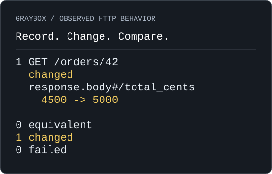

<h1 align="center">Graybox</h1>
<p align="center"><strong>Know what changed.</strong></p>
<p align="center">Record what an API does. Change the code. Verify what changed.</p>
<p align="center">
  <a href="#get-started">Install</a> ·
  <a href="#try-it-an-authenticated-order-api">Try the example</a> ·
  <a href="#documentation">Documentation</a> ·
  <a href="https://github.com/ViniTamanhao/graybox-core/releases">Releases</a>
</p>

Graybox is a local-first Go CLI that preserves observed HTTP behavior in portable
recordings. Replay requests after a code change and see which response fields
changed. No account or cloud service required.

## See the difference

A $50 order, a $5 discount, and a change that forgets to subtract it.
The [included API](examples/server) makes the difference visible:



This is an excerpt from an executed Graybox comparison. The recorded total was
4500 cents; the changed application returned 5000. `graybox diff` identified
`response.body#/total_cents` and exited **1**. Restoring the discount produced
**1 equivalent** and exit **0**, using the same unchanged recording.
[Run it yourself below](#try-it-an-authenticated-order-api).

## Why Graybox?

A refactor can change what an API returns, even when its tests pass. Alongside
unit tests for intended cases, keep a record of what the running API actually
did. Graybox gives you that reusable baseline and a focused comparison after
you change the application.

A difference is an observation to investigate. Your requirements determine
whether it is an intended change or a regression. Equivalence covers the selected
recording and comparison policy; unrecorded behavior remains outside that claim.

## Get started

Install the **published v0.3.0 CLI** with a [patched Go toolchain](docs/installation.md#source):

```bash
go install github.com/ViniTamanhao/graybox-core/cmd/graybox@v0.3.0
graybox version
```

Prefer a binary? [Download a release](https://github.com/ViniTamanhao/graybox-core/releases/tag/v0.3.0)
for Linux, macOS or Windows. Follow the [checksum and PATH instructions](docs/installation.md#prebuilt-binaries).
Prebuilt binaries need no Go installation.

**Next: v0.3.1 (not published).** This branch prepares the README and portable
Agent Skills update. Keep using the published command above today. The
[post-publication instructions](docs/installation.md#planned-v031-installation)
include the planned `@v0.3.1` install; its module and artifacts must exist first.
See the [draft release notes](docs/releases/v0.3.1.md).

## How it works

**Record → Inspect → Change → Diff → Verify**

1. **Record** requests through Graybox's HTTP reverse proxy into a SQLite `.graybox` file.
2. **Inspect** the requests, responses and body completeness before trusting the baseline.
3. **Change** your application while preserving the pre-change recording.
4. **Diff** the changed application: Graybox replays requests and compares responses.
5. **Verify** intended changes or fix regressions, then compare again when safe.

| Command | Use it to… |
| --- | --- |
| `graybox record` | Capture HTTP requests and responses |
| `graybox ls` / `graybox show` | Find and inspect recorded exchanges |
| `graybox replay` | Execute recorded requests sequentially |
| `graybox diff` | Execute requests **and compare** responses |

Run `graybox help <command>` for options.

**Compare precisely.** JSON compares semantically, with exact numbers and
positional arrays. Other complete bodies compare byte-for-byte. Status and headers
are compared too; Date and Content-Length are ignored by default. Add explicit
[ignored locations](docs/diffing.md#ignored-locations) for values you choose to exclude.

**Keep evidence portable.** Recordings are local SQLite files. Inspection, replay
and diff leave them unchanged. [JSON reports and documented exit codes](docs/agent-verification-contract.md)
make results usable in scripts and coding-agent workflows. Empty success provides
no coverage; incomplete evidence can fail a comparison.

**Control sensitive data.** Mandatory header redaction and optional
[configuration](docs/configuration.md) protect selected values. Runtime credentials
are injected into outgoing requests without writing them back to the recording.
Review recordings and reports before sharing: redaction does not detect every secret.

## Try it: an authenticated order API

Use the synthetic, read-only [order API](examples/server/README.md). It has no
external integrations and uses a public demo credential. For other applications,
replay and diff can repeat writes: use an authorized disposable environment with
real integrations disabled. A loopback address alone does not establish safety.

You need Go, curl, three terminals, and free ports 8080 and 9000. Clone the
repository and run each terminal from its root:

```bash
git clone https://github.com/ViniTamanhao/graybox-core.git
cd graybox-core
```

**1. Capture the accepted behavior.** In terminal 1, build Graybox and start the API:

```bash
go build -o graybox ./cmd/graybox
go run ./examples/server
```

In terminal 2, start the recorder. Choose a fresh output filename; existing files
are refused. Keep recordings outside version control.

```bash
./graybox record \
  --target http://127.0.0.1:8080 \
  --output order.graybox
```

Wait for both startup messages. In terminal 3, send an authenticated request:

```bash
export API_AUTH='Bearer demo-token'
curl --fail-with-body \
  http://127.0.0.1:9000/orders/42 \
  -H "Authorization: $API_AUTH"
```

Check that `total_cents` is **4500**. Stop the recorder with Ctrl+C in terminal 2
and check for capture errors. In terminal 3, inspect the preserved evidence:

```bash
./graybox ls order.graybox
./graybox show order.graybox 1
```

Expect `200 OK`, `Authorization: <REDACTED>`, and complete, non-truncated bodies.

**2. Change the application.** Stop the API with Ctrl+C in terminal 1, then enable
the demo's deliberate missing-discount bug:

```bash
go run ./examples/server --regressed
```

The flag changes the running application's pricing behavior without editing source.

**3. Compare and verify.** In terminal 3, supply the runtime credential and compare:

```bash
./graybox diff order.graybox \
  --secret-header Authorization=API_AUTH
```

The output shown above reports **4500 → 5000**, with exit **1**. Here the missing
discount is a known bug. Without the credential, you would compare a 401 response
instead of the pricing change.

Stop the API, restart it without `--regressed`, and run the same diff command.
Expect **1 equivalent**, **0 changed**, **0 failed**, exit **0**. Stop the API when
finished; preserve the original recording. The [full walkthrough](examples/server/README.md)
includes authenticated replay, port overrides and automated checks.

## Working with coding agents

The CLI works independently of AI. The separate [Agent Skills package](docs/agent-skill.md)
guides compatible coding agents through baseline inspection, safe execution and
reporting backed by command evidence during relevant API tasks.

**Codex has bounded live validation.** Claude Code, Cursor and Copilot have
documented installation paths and structural compatibility checks; no completed
live validation is recorded for those clients. Installation does not guarantee
automatic activation or improved coding correctness. See the
[portability evidence](docs/agent-skill-portability.md).

Install the executable and instruction package separately. The guide distinguishes
the published v0.3.0 skill from the portable update planned for v0.3.1 and gives
project-specific installation paths.

## Documentation

- **Start using Graybox:** [Installation](docs/installation.md) · [Order API walkthrough](examples/server/README.md)
- **Configure a project:** [Redaction and runtime credentials](docs/configuration.md)
- **Understand a result:** [Comparisons, ignores and exit codes](docs/diffing.md) · [JSON contract](docs/agent-verification-contract.md)
- **Work with agents:** [Install the skill](docs/agent-skill.md) · [Verification workflow](docs/agent-verification-workflow.md)
- **Understand the boundaries:** [Security and side effects](docs/SECURITY.md) · [Recording format](docs/recording-format.md)
- **Review the evidence:** [Skill evaluations](docs/agent-skill-evaluation.md) · [CLI failure handling](docs/agent-cli-reliability.md) · [End-to-end trials](docs/agent-end-to-end-evaluation.md)
- **Contribute:** [Architecture](docs/architecture.md) · [Contribution guide](docs/CONTRIBUTING.md) · [Release notes](docs/releases/v0.3.1.md)

Graybox is [MIT licensed](LICENSE). Report bugs and discuss improvements in
[GitHub Issues](https://github.com/ViniTamanhao/graybox-core/issues).
